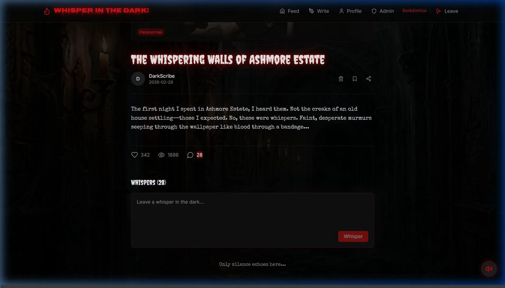
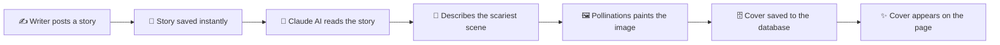

<div align="center">

# 🩸 Eerie Echoes

### A home for horror stories, told in the dark

*Write, read and share bone-chilling tales, each one with its own AI-painted cover.*




</div>

---

## 💀 What is Eerie Echoes?

Eerie Echoes is a **gothic storytelling platform** for horror fans. Writers publish their own scary stories, and readers explore them, like them and leave comments, which the site calls *whispers*.

The whole site feels like stepping into a haunted house: a dramatic intro, drifting fog, flickering light, ambient sounds and the occasional jump scare. 👻

The standout feature is **AI cover art**. When a writer posts a story without a picture, an AI reads the story, picks its most striking scene, and paints a unique cover for it automatically.

## 🕯️ Features

| | Feature | What it means for you |
|---|---|---|
| ✍️ | **Publish stories** | Write and share your own horror tales |
| 🎨 | **AI cover art** | Every story gets a unique cover painted from its plot |
| 📚 | **Categories** | Paranormal, Psychological, Urban Legends, True Horror, Dark Fantasy |
| 🔍 | **Search** | Find stories by title or category |
| 🖤 | **Likes and whispers** | React to stories and leave comments |
| 📜 | **Story adoption** | Apply to adapt someone's story |
| 🔊 | **Ambient audio** | Creepy background soundscapes while you read |
| 🔐 | **Secure accounts** | Sign up, email verification and password reset |
| 👑 | **Admin panel** | Moderate stories and users, and feature the best tales |

## 🎨 How the AI cover works



The story goes live straight away with a placeholder. The painting happens quietly in the background, and the cover appears on the page as soon as it's ready.

## 🧩 How the site works

1. The **website** (React) shows the stories and the haunted visuals.
2. It talks to the **server** (Node.js and Express), which checks who you are and what you're allowed to do.
3. Stories, comments, likes, users and images are kept in a **MongoDB** database.

## 🛠️ Built with

- **Frontend:** React, TypeScript, Vite, Tailwind CSS, Framer Motion
- **Backend:** Node.js, Express, MongoDB with Mongoose
- **AI:** Claude (scene description) and Pollinations (image generation)
- **Security:** bcrypt passwords, JWT logins, email verification, rate limiting
- **Quality:** 331 automated tests
- **Hosting:** Vercel or Docker

## 🚀 Run it yourself

```bash
npm install
cp .env.example .env     # add your MongoDB connection string
npm run dev              # website on :3000, server on :5000
```

Open **http://localhost:3000**. Demo login: `nightcrawler@void.com` / `darkness123`

## 📚 More details

For the API reference, security work, test breakdown and deployment guide, see [`docs/TECHNICAL.md`](docs/TECHNICAL.md).

---

<div align="center">

Made with 🕯️ by **Ekansh Singh** · [GitHub](https://github.com/ekansh2010) · [LinkedIn](https://www.linkedin.com/in/ekansh-singh-005887289/)

</div>
