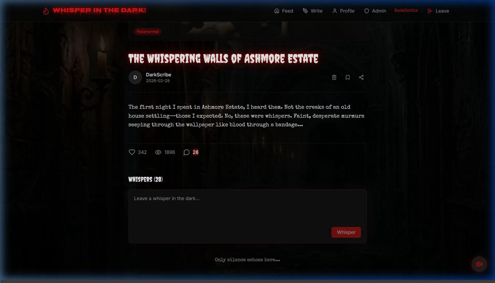

# 🩸 Eerie Echoes — Haunting Story Teller 💀

An immersive, gothic-themed web platform for publishing, reading, and listening to bone-chilling horror stories — with AI-generated covers, ambient audio, likes, whispers (comments), story adoption, and an admin "banishment" panel.



- **Frontend:** React 18 · Vite · TypeScript · TailwindCSS · Framer Motion · TanStack Query
- **Backend:** Node.js (≥ 20) · Express 5 · MongoDB/Mongoose 9 · Zod · JWT · bcrypt · Helmet · express-rate-limit · Multer · Nodemailer
- **Tests:** Vitest · Supertest · mongodb-memory-server (**315 tests**: 308 backend + 7 frontend)
- **Deploy:** Vercel (serverless API + static SPA), or one Docker container

---

## ✅ Project checklist — what was done

### 1. Errors fixed
- [x] Frontend TypeScript error: `UploadPage.tsx` passed `queryKey` to `useMutation` (TS2353). It now uses `mutationKey`.
- [x] All **29 ESLint errors** fixed with real types, not rule disables:
  - [x] Added shared API types (`StoryDetail`, `PaginatedStories`, `Comment`, `Application`, `UploadResponse`, `ApiError`).
  - [x] Caught errors are now `unknown` and handled through `getErrorMessage()`.
  - [x] `tailwind.config.ts` uses an ESM import instead of `require`.
- [x] **Deploy bug:** `vercel.json` had no SPA fallback, so refreshing a deep link like `/story/1` returned 404 on Vercel. Added a rewrite that sends every non-`/api` route to `index.html`.
- [x] **Deploy bug:** the Express static path pointed at `../dist` instead of `frontend/dist`.
- [x] **Deploy bug:** uploads were written to the local disk. Vercel's filesystem is read-only, so the folder could not be created there, and files disappeared on every redeploy anyway. Images are now stored in MongoDB.
- [x] **Data-loss bug:** the old seeder deleted **all stories, comments and likes** on boot whenever demo comment `c1` was missing, for example after an admin deleted that comment. Seeding is now idempotent and never deletes data.
- [x] **Race fixes:**
  - [x] Requests no longer race first-boot seeding.
  - [x] A "like" toggle is atomic, so concurrent requests can't create duplicate likes.
  - [x] Like/comment counts are computed live instead of from counters that drifted.
- [x] `@types/mongoose` (v5 types, which conflict with Mongoose 9) removed. Type-only packages moved to `devDependencies`.
- [x] `npm audit fix` cleared the **critical** advisories in `mongoose` and `proxy-addr` and the high one in `multer`, with no breaking upgrades. The remaining advisories are listed under follow-ups.

### 2. Security hardening
- [x] **Account takeover closed.** The login page's "reset password" sent `{email, newPassword}` with **no proof of ownership**. Reset is now a link sent by email that contains a single-use token and expires after 1 hour.
- [x] **Self-verification closed.** `POST /auth/verify` used to mark the caller's email verified without any check. Now it only re-sends the email, and the account is verified only through the emailed token.
- [x] Email and reset tokens are stored as **SHA-256 hashes**. The raw token only ever appears in the email.
- [x] A password reset **revokes all existing sessions**: the `tokenVersion` counter is stored in each JWT and checked on every request.
- [x] Each authenticated request **reloads the user from the DB**. Banned users and role changes take effect immediately, and a forged `role` in a token is ignored.
- [x] JWTs only accept the `HS256` algorithm. A bad token returns 401 instead of 403.
- [x] **Startup refuses to run in production** without `MONGODB_URI`, or with a missing or publicly known `JWT_SECRET`.
- [x] **Regex/NoSQL injection removed.** User input is no longer placed raw inside `new RegExp`:
  - [x] Search and category input is escaped first.
  - [x] Email and username lookups use a case-insensitive collation instead of a regex.
- [x] **Login timing equalised.** A dummy bcrypt comparison runs when the email doesn't exist, and both cases return the same 401. Forgot-password gives the same response whether or not the email exists.
- [x] bcrypt cost raised from 10 to 12.
- [x] **Uploads:**
  - [x] File type is detected from the file's **magic bytes**. The extension and declared mimetype are not trusted.
  - [x] Size limit is 4 MB, under Vercel's request-body limit.
  - [x] Images are served with `nosniff` and a sandbox CSP.
- [x] **Image URLs** (`avatar`, `coverImage`) are validated. Only `http(s)`, `/api/uploads/...` or `/images/...` are accepted, which blocks `javascript:` and `data:` URLs.
- [x] Helmet security headers are set, `x-powered-by` is removed, and `trust proxy` is set so client IPs are correct behind a proxy.
- [x] **CORS:** the allow-list comes from `CORS_ORIGIN`. In production with no list set, only same-origin requests are allowed.
- [x] **Rate limits:**

  | Limit | Applies to | Allowance |
  |---|---|---|
  | Global | All `/api` routes | 600 per 15 min |
  | Login/register/reset | Credential endpoints | 20 failed attempts per 15 min |
  | Email | Forgot-password, resend verification | 5 per hour |
  | Contact | Contact form | 10 per hour |
  | Writes | Stories, comments, uploads | 100 per 15 min |

- [x] **Body size and input limits:**
  - [x] Request bodies are capped at 200 KB.
  - [x] Every field has a length limit.
  - [x] Unknown fields are stripped, so a client can't send fields like `featured`, `views` or `authorId`.
- [x] **Authorization:**
  - [x] Only admins can update application status or read contact submissions.
  - [x] An admin cannot ban themselves or another admin.
  - [x] You cannot apply to adopt your own story, and you cannot submit a duplicate pending application.

### 3. Backend architecture (proper principles)
- [x] **Layered structure:**
  - [x] Routes handle HTTP wiring.
  - [x] Middleware handles auth, validation, rate limits and errors.
  - [x] Controllers hold the request logic.
  - [x] Services hold the domain logic.
  - [x] Models define schemas and indexes.
  - [x] Config holds validated environment settings.
- [x] **App factory** (`createApp()`) with no side effects. The same app runs the local server, the Vercel function and the tests.
- [x] **Central error handling.** Every error comes back as JSON `{ error, details? }` with the correct status:

  | Status | When |
  |---|---|
  | 400 | Validation errors and malformed JSON |
  | 401 | Missing or invalid authentication |
  | 403 | Authenticated but not allowed |
  | 404 | Resource or route not found |
  | 409 | Duplicates |
  | 413 | Body or upload too large |
  | 503 | Database unavailable |
  | 500 | Anything unexpected; the response stays generic and the details go to the log |

  Unknown `/api` routes return a JSON 404 instead of the SPA's HTML.
- [x] **Validation:** Zod schemas for body, query and params, applied by one generic `validate()` middleware.
- [x] **Database connection:** connections are cached so serverless instances reuse them, and the connection retries after a failure.
- [x] **No N+1 queries:** a story list now runs a fixed 4 queries, instead of 4 per story.
- [x] **Indexes:** on story `createdAt`, `category` and `authorId`; comments by `storyId` + `createdAt`; a unique index on `(userId, storyId)` for likes; and the token fields.
- [x] **Cascading deletes:** deleting a story or banning a user removes the related comments, likes, applications and uploads.
- [x] **Email sending** is awaited, so it completes on serverless, and it never makes the request fail. Without SMTP, development uses an Ethereal test inbox and production skips sending with a warning.
- [x] **Operations:**
  - [x] Structured, levelled logger.
  - [x] Per-request access log.
  - [x] `/health` and `/api/health` check the database.
  - [x] Graceful shutdown on SIGTERM/SIGINT.
  - [x] gzip compression.
- [x] **Seeding:**
  - [x] An admin is created from `ADMIN_EMAIL`/`ADMIN_PASSWORD`.
  - [x] Demo data is seeded only into an empty database, and only when `SEED_DEMO_DATA` is on. It is on by default in development and off in production.
- [x] **Backwards compatible** with existing data and the frontend: string `id`s, the same response shapes, and the same date formats. `_id` and `__v` are removed from all responses.

### 4. Frontend updated for the secure flows
- [x] **Login:** the "forgot password" modal now asks only for an email and sends a reset link.
- [x] **New page `/reset-password`:** the user sets a new password using the token from the email.
- [x] **New page `/verify-email`:** consumes the token from the email and refreshes the logged-in user.
- [x] **Profile:** the button now reads "Resend verification email". It no longer marks the email verified on the client.
- [x] Password rules are shared by register and reset (at least 8 characters, with a letter and a number), and they match the backend.

### 4b. Performance, cleanup and AI covers
- [x] **Fast loading:** 71 MB of PNG art converted to WebP (about 1 MB in total); API functions run in Mumbai (`bom1`) next to the database; routes are code-split; static assets are long-cached.
- [x] **Intro** plays once per session and has a Skip button.
- [x] **Cleanup:** removed 46 unused UI files, 39 unused packages and duplicate images.
- [x] **AI story covers.** When a story is posted without a cover:
  1. It is saved immediately with a placeholder.
  2. In the background, **Claude** (`claude-opus-5-5`) reads the whole story and writes a description of its most striking scene.
  3. **Pollinations** renders that description as an image.
  4. The **image itself is stored in MongoDB** and served from `/api/uploads/ai_…`, so it is permanent and never changes.
  - The story page updates live while the cover is being painted.
  - Authors and admins can **Repaint with AI**.
  - Without `ANTHROPIC_API_KEY`, the prompt is built from the title, category and opening lines instead.
  - `GET /api/stories/:id/cover` returns the cover status; `POST` repaints it.

### 5. Tests — `npm test` (all passing)

| Suite | File | Tests | Covers |
|---|---|---:|---|
| Integration | `backend/tests/integration/auth.test.ts` | 38 | register/login/me, duplicates, token forgery/revocation, verify & reset flows, avatar |
| Integration | `backend/tests/integration/stories.test.ts` | 120 | list/paginate/filter/search, injection, detail/views, create, likes (+concurrency), comments, deletes & cascades, applications, contact |
| Integration | `backend/tests/integration/admin.test.ts` | 23 | access control, stats, users (no secrets), ban + full cascade, feature toggle |
| Integration | `backend/tests/integration/uploads.test.ts` | 11 | auth, PNG/GIF round-trip, spoofed files, size limit, headers |
| Integration | `backend/tests/integration/app.test.ts` | 11 | health, JSON 404, malformed/oversized bodies, security headers, CORS, audio tracks |
| Integration | `backend/tests/integration/seed.test.ts` | 9 | idempotent, non-destructive (old data-loss bug), admin from env |
| Integration | `backend/tests/integration/aiCover.test.ts` | 15 | AI cover pipeline (mocked Claude + image API), placeholder → stored image, failures, repaint auth, cleanup |
| Unit | `backend/tests/unit/*.test.ts` | 96 | helpers, image sniffing, serializers, validation schemas, env/config rules |
| Frontend | `frontend/src/test/*.test.ts` | 7 | password/email validation rules |

Each backend test file starts its own **in-memory MongoDB**, so tests need no external database, and every test begins with a clean database.

### 6. Delivery
- [x] `README.md` (this file) and `.env.example`.
- [x] `vercel.json` sets the build command, the output directory, the API function and the SPA fallback.
- [x] `Dockerfile` (multi-stage build, runs as non-root, with a healthcheck) and `.dockerignore`.
- [x] Verification commands, all green:
  - [x] `npm run typecheck`: 0 errors.
  - [x] `npm run lint`: 0 errors.
  - [x] `npm run build`: succeeds.
  - [x] `npm test`: 315 passing.
  - [x] A smoke test booted the real server against a live database and checked health, stories, admin login, the SPA deep link and the API 404.

### Follow-ups (not done — need a decision or a major upgrade)
- [ ] **Major-version upgrades.** `npm audit` still reports advisories that can only be fixed by a major upgrade:
  - [ ] `zod` 3 → 4: exposure is limited, because these schemas have no unbounded collections and bodies are capped at 200 KB.
  - [ ] `nodemailer` 9 → 10+.
  - [ ] `react-router-dom` 6 → 7.
  - [ ] dev-only `glob`/`minimatch`.
- [ ] **Rate limits on serverless:** the limits are kept in memory for each function instance. For strict global limits on Vercel, plug a Redis or Upstash store into `express-rate-limit`.
- [ ] **Unverified accounts:** they can still post. To require verification, add a `requireVerified` middleware to the write routes.
- [x] **Bundle size:** fixed. Routes are code-split and vendor chunks are separate.

---

## 🧙 Run locally

```bash
npm install
cp .env.example .env        # then fill in values (see below)
npm run dev                 # API on :5000 + Vite on :3000 (Vite proxies /api → :5000)
```

You need a MongoDB to connect to: either a local `mongod`, or a free Atlas cluster with its URI in `MONGODB_URI`. In development, demo data is seeded on first boot. Log in as `darkscribe@void.com` / `darkness123` (admin) or e.g. `nightcrawler@void.com` / `darkness123`.

Without SMTP settings, verification and reset emails go to an **Ethereal** test inbox, and a preview link is printed in the server log.

### Scripts
| Script | What it does |
|---|---|
| `npm run dev` | API (nodemon + tsx) and frontend together |
| `npm start` | Production server: API + built SPA on `PORT` |
| `npm run build` | Build the frontend into `frontend/dist` |
| `npm test` | Backend + frontend test suites |
| `npm run test:backend` / `test:frontend` | One suite only |
| `npm run typecheck` | `tsc` for backend and frontend |
| `npm run lint` | ESLint (frontend) |

## ⚙️ Environment variables

See [`.env.example`](../.env.example) for the full list. The important ones:

| Variable | Required | Notes |
|---|---|---|
| `MONGODB_URI` | **prod** | MongoDB/Atlas connection string |
| `JWT_SECRET` | **prod** | Long random value. Generate one with `node -e "console.log(require('crypto').randomBytes(48).toString('hex'))"`. The old README's default is rejected in production. |
| `FRONTEND_URL` | yes | Public site URL, used in email links |
| `SMTP_HOST` / `SMTP_PORT` / `SMTP_USER` / `SMTP_PASS` / `SMTP_FROM` | for email | Without them, emails are not delivered in production |
| `ADMIN_EMAIL` / `ADMIN_PASSWORD` / `ADMIN_USERNAME` | first boot | Creates the admin account if no admin exists |
| `SEED_DEMO_DATA` | no | `true` to seed demo stories into an empty database. Defaults to off in production. |
| `CORS_ORIGIN` | no | Only needed if the frontend is served from a different domain |
| `ANTHROPIC_API_KEY` | for AI scene analysis | Lets Claude read each story and describe the cover scene. Without it, covers are still generated from the title and opening lines. |
| `AI_COVERS_ENABLED` | no | Defaults to `true` (off in tests). Set to `false` to keep the old title-only placeholder covers. |
| `AI_COVER_MODEL` | no | Defaults to `claude-opus-5-5` |

## 🚀 Deploy

### Vercel (recommended; already configured)
1. Import the repo in Vercel. `vercel.json` already sets the build command (`npm run build`), the output (`frontend/dist`) and the serverless API (`api/index.ts`).
2. In **Project → Settings → Environment Variables**, set `NODE_ENV=production`, `MONGODB_URI`, `JWT_SECRET`, `FRONTEND_URL`, and optionally SMTP and `ADMIN_*`.
3. In MongoDB Atlas, allow Vercel's IPs (or `0.0.0.0/0`) under Network Access.
4. Deploy, then check `https://<your-app>/api/health`. It should return `{"status":"alive in the void","db":"connected"}`.

### Docker / any VM / Render / Railway
```bash
docker build -t eerie-echoes .
docker run -p 5000:5000 --env-file .env -e NODE_ENV=production eerie-echoes
```
This one container serves both the API and the SPA. Without Docker, run `npm ci && npm run build && NODE_ENV=production npm start`.

## 📡 API reference

All endpoints are under `/api` and use JSON. Errors are returned as `{ "error": string, "details"?: [...] }`. 🔒 = needs `Authorization: Bearer <jwt>`, 👑 = admin only.

| Method | Path | Auth | Description |
|---|---|---|---|
| POST | `/auth/register` | | `{username, email, password}` → `{token, user}` and sends a verification email |
| POST | `/auth/login` | | `{email, password}` → `{token, user}` |
| GET | `/auth/me` | 🔒 | Current user |
| POST | `/auth/verify` | 🔒 | Re-send the verification email |
| POST | `/auth/verify-token` | | `{token}` → `{message, user}` |
| POST | `/auth/forgot-password` | | `{email}` → emails a reset link. `/auth/reset-password` is a legacy alias for the same thing. |
| POST | `/auth/reset-password-confirm` | | `{token, newPassword}`; also revokes every existing session |
| PATCH | `/auth/avatar` | 🔒 | `{avatar}` → updated user |
| GET | `/stories` | optional | `?page&limit(≤50 or "all")&category&search` → `{stories, page, totalPages, totalStories, limit}`; with `limit=all` returns an array |
| POST | `/stories` | 🔒 | `{title, content, category, coverImage?}`. Leave out `coverImage` to get an AI cover. |
| GET | `/stories/:id` | optional | Story, `commentList`, and `likedByUser`. Each call counts a view. |
| DELETE | `/stories/:id` | 🔒 author/👑 | Deletes the story and its comments, likes and applications |
| POST | `/stories/:id/like` | 🔒 | Toggle → `{liked, likes}` |
| POST | `/stories/:id/comments` | 🔒 | `{text}` |
| DELETE | `/stories/:id/comments/:commentId` | 🔒 | Allowed for the comment author, the story author or an admin |
| POST | `/stories/:id/apply` | 🔒 | `{notes?}`: apply to adopt the story |
| GET | `/stories/applications` | 🔒 | Your applications; admins see all |
| PATCH | `/stories/applications/:id` | 👑 | `{status: pending\|approved\|rejected}` |
| POST | `/stories/contact` | | `{name, email, message}` |
| GET | `/stories/contacts` | 👑 | Contact submissions |
| POST | `/upload` | 🔒 | multipart field `image` (jpg/png/gif/webp, ≤ 4 MB) → `{url: "/api/uploads/<id>"}` |
| GET | `/uploads/:id` | | Returns the stored image |
| GET | `/audio-tracks` | | Ambient tracks |
| GET | `/admin/stats` · `/admin/users` | 👑 | Dashboard stats and user list |
| DELETE | `/admin/users/:id` | 👑 | Ban a user and remove all their content |
| POST | `/admin/stories/:id/feature` | 👑 | Toggle featured → `{featured}` |
| GET | `/health` | | Liveness and database status |

## 🗂️ Project structure

```
api/index.ts                 Vercel serverless entry (wraps createApp)
backend/
  index.ts                   Local/Docker server: listen, serve SPA, graceful shutdown
  src/
    app.ts                   createApp(): middleware, routes, error handling
    config/env.ts            Zod-validated environment (fails fast in production)
    database/                connection (cached), seed (idempotent)
    models/                  Mongoose schemas + indexes
    middleware/              auth, validate, rateLimit, error
    validation/              Zod request schemas
    controllers/             auth, stories, admin
    services/                story enrichment/cascades, email, uploads, serializers
    routes/                  auth, stories, admin, upload, audio
    utils/                   HttpError, logger, helpers
  tests/                     unit + integration (in-memory MongoDB)
frontend/                    React SPA (Vite)
```

---

## 💀 Contributing to the Dark
Open a pull request. Run `npm run typecheck && npm run lint && npm test` before submitting, and keep the eerie aesthetic.
